# Manual de usuario — SGTU (Sistema de Gestión de Turnos Universitarios)

Para quién: personal de ventanilla que atiende turnos en un solo equipo.

## 1. Cómo abrir el programa
Requisitos: Java 17 o superior.
1. Abra una terminal en la carpeta del proyecto.
2. Escriba `java -jar target/sgtu.jar` (si no existe, primero `mvn -DskipTests package`).
3. Los datos se guardan automáticamente en `datos/turnos.txt`. Para usar otro archivo: `java -jar target/sgtu.jar ruta/archivo.txt`.

Al abrirse, verá la pantalla principal:

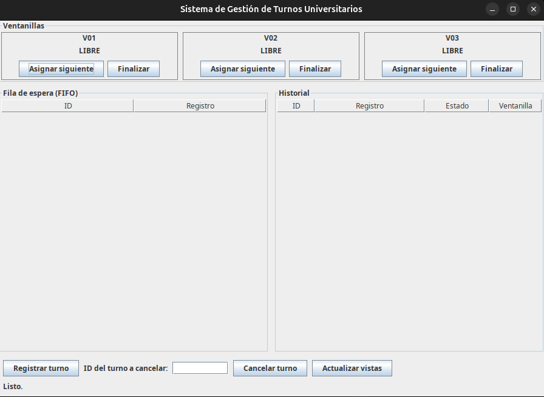

La pantalla tiene cuatro zonas:

| Zona | Qué muestra |
|---|---|
| **Ventanillas** | V01, V02 y V03. Cada una dice «LIBRE» u «OCUPADA: `<turno>` (En atención)» y tiene los botones *Asignar siguiente* y *Finalizar* |
| **Fila de espera (FIFO)** | Los turnos En espera, del más antiguo al más reciente |
| **Historial** | Todos los turnos con su estado y ventanilla |
| **Barra de mensajes** (abajo) | Resultado de la última acción, también cuando es un error |

## 2. Estados de un turno

| Estado | Significado | Color en el historial |
|---|---|---|
| En espera | Registrado, aún sin ventanilla | Amarillo claro |
| En atención | Se está atendiendo en una ventanilla | Azul claro |
| Atendido | La atención terminó | Verde claro |
| Cancelado | Se canceló antes de ser atendido | Rojo claro |

El estado siempre aparece escrito; el color solo ayuda a distinguirlo.

## 3. Operaciones

### 3.1 Registrar un turno
Pulse **Registrar turno**. El sistema asigna el siguiente identificador (T001, T002…) y lo coloca al final de la fila.

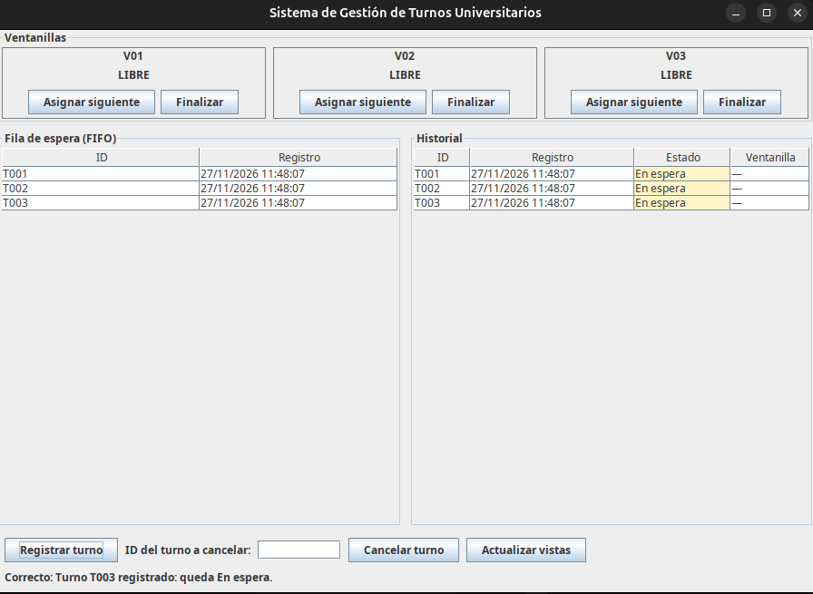

### 3.2 Asignar el siguiente turno a una ventanilla
En la tarjeta de la ventanilla libre pulse **Asignar siguiente**. Recibe el turno más antiguo de la fila y su atención inicia de inmediato.

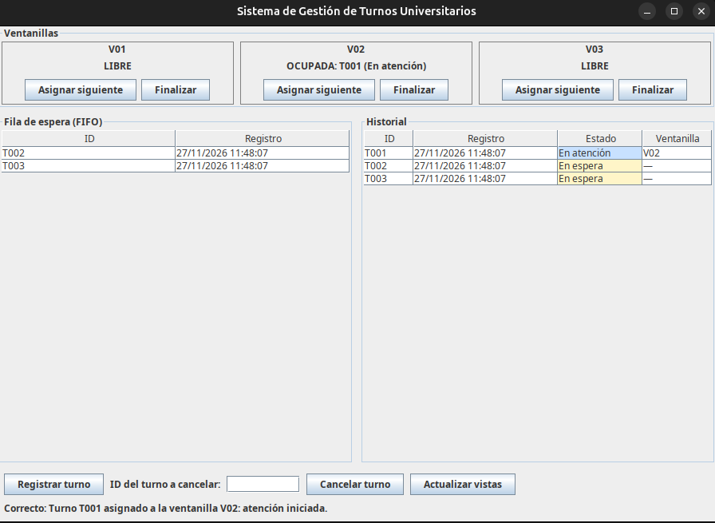

Si la ventanilla ya está ocupada o no hay turnos en espera, el sistema lo informa y no cambia nada.

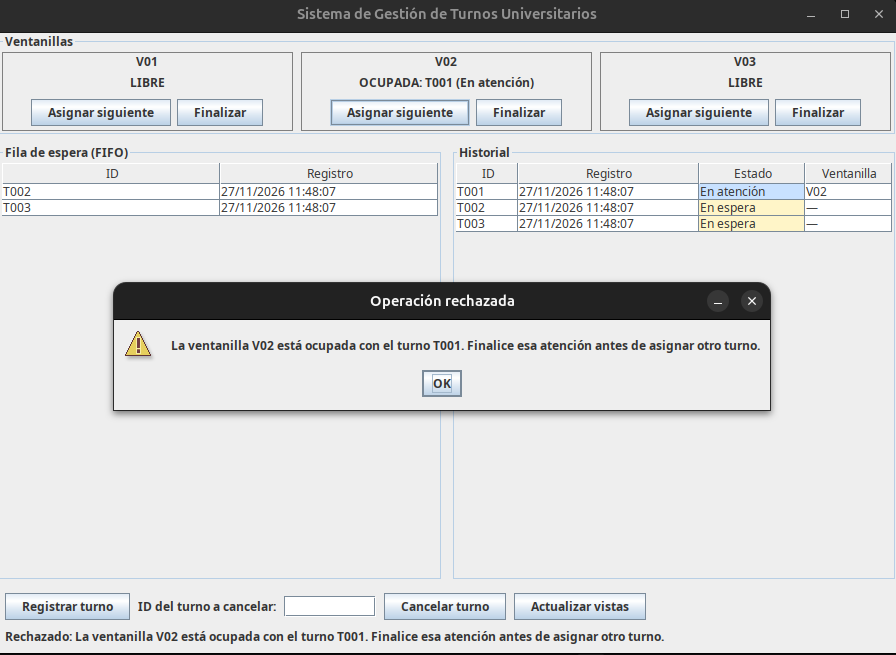

### 3.3 Finalizar una atención
Pulse **Finalizar** en la ventanilla ocupada. El turno queda *Atendido* y la ventanilla *libre*.

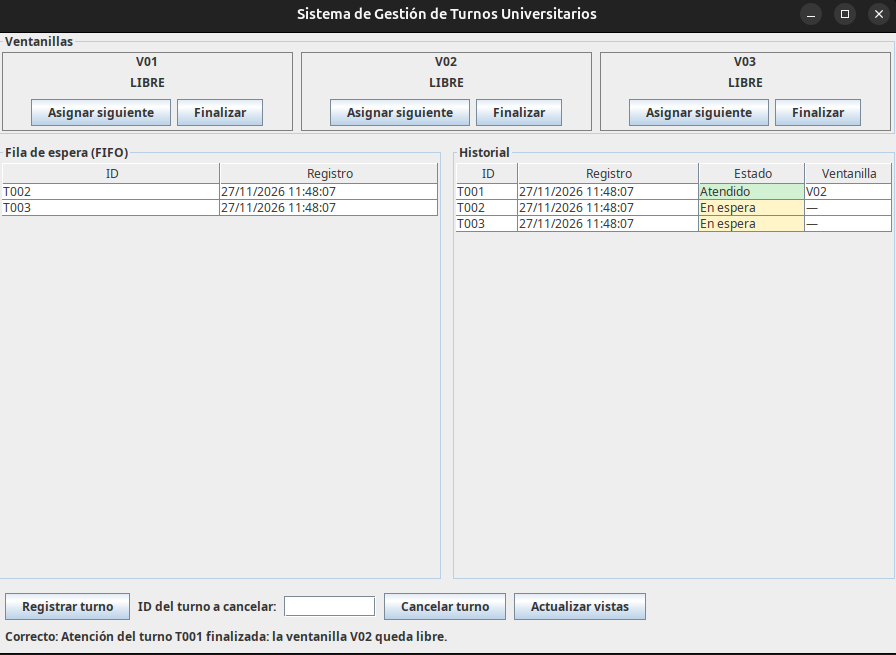

### 3.4 Cancelar un turno
1. Escriba el identificador (por ejemplo `T002`) en «ID del turno a cancelar».
2. Pulse **Cancelar turno** y confirme con **Sí**.

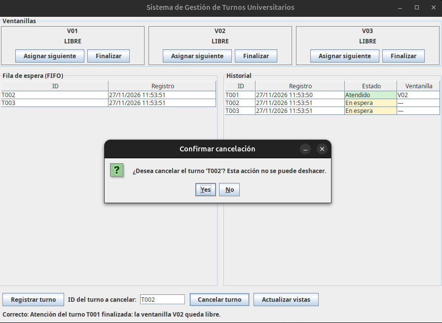

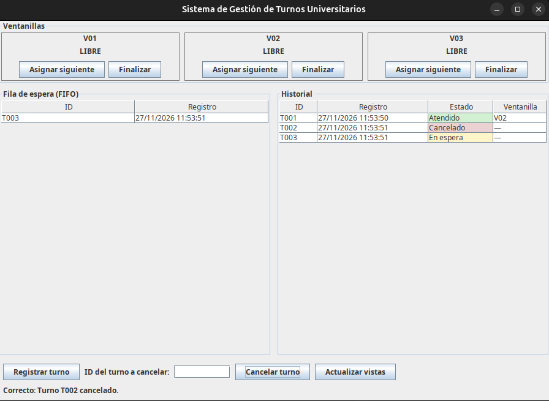

Solo se cancelan turnos **En espera**. Un turno En atención, Atendido o Cancelado no se puede cancelar. Si responde **No** no se hace ningún cambio. Si el identificador no existe, o el campo está vacío, se muestra un aviso.

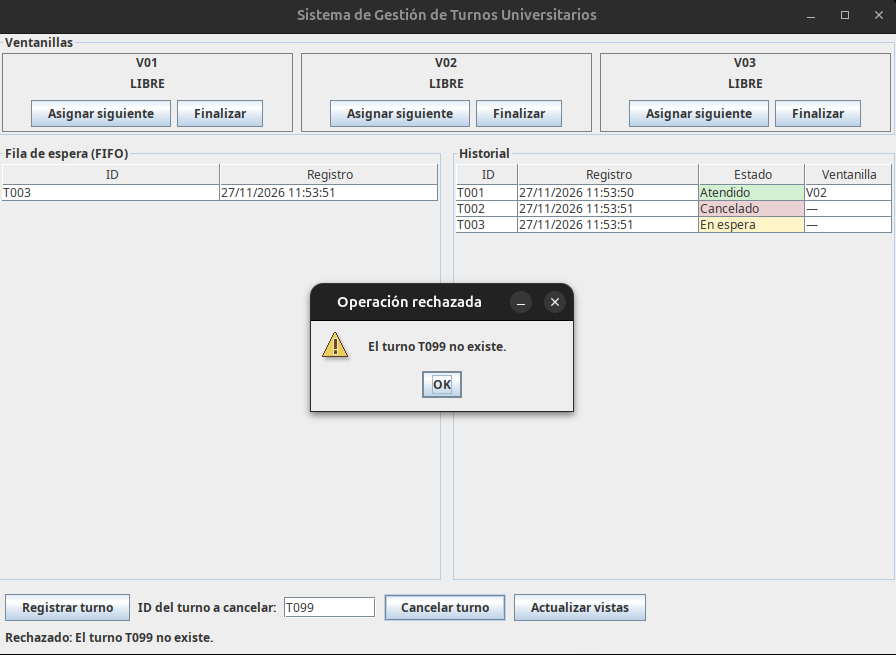

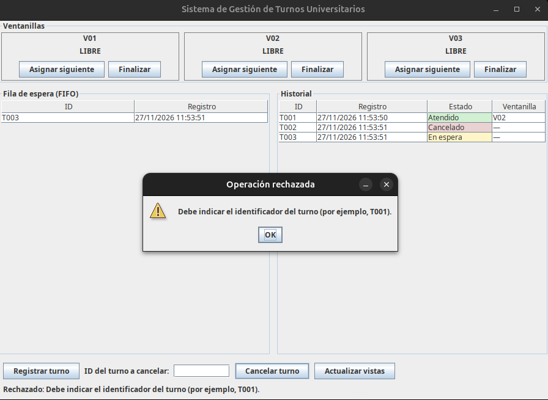

### 3.5 Actualizar vistas
**Actualizar vistas** vuelve a leer el estado del sistema y redibuja las tres zonas. Normalmente no hace falta, porque cada operación ya actualiza la pantalla.

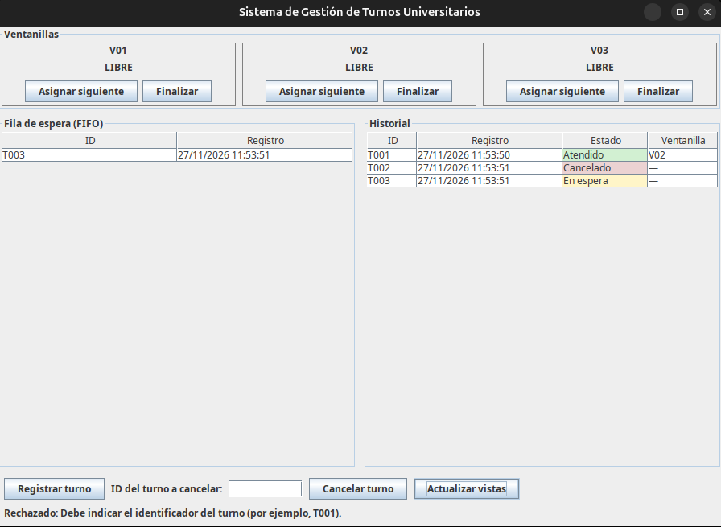

## 4. Cerrar y volver a abrir
Cada operación se guarda al instante. Al abrir de nuevo, se recuperan los turnos, sus estados y las ventanillas ocupadas, y los números de turno **no se reutilizan**.

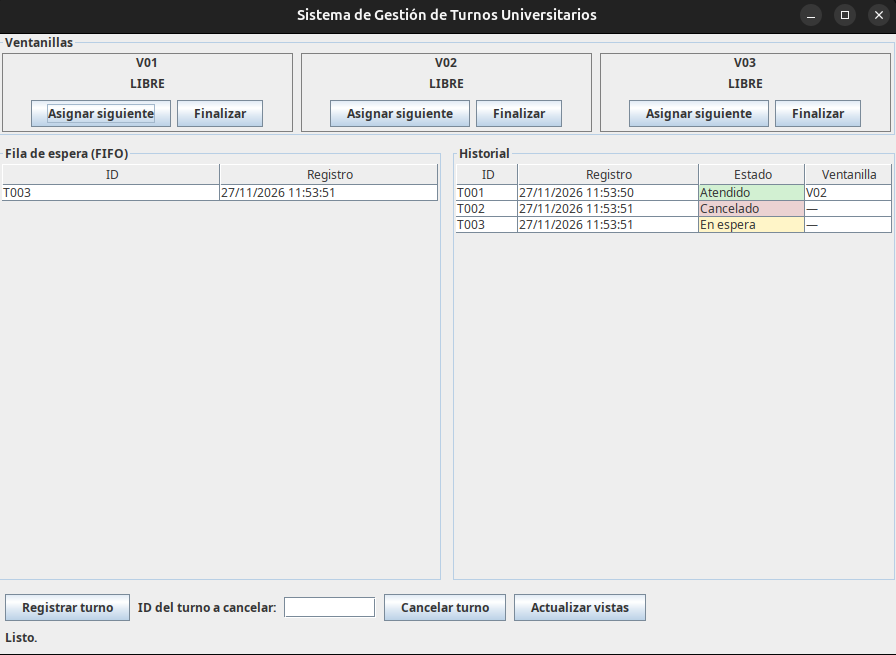

## 5. Mensajes de error frecuentes

| Mensaje (resumen) | Qué significa | Qué hacer |
|---|---|---|
| La ventanilla ya está ocupada | Intentó asignar a una ventanilla con atención en curso | Finalice la atención y asigne de nuevo |
| No hay turnos en espera | La fila está vacía | Registre un turno |
| La ventanilla está libre: no hay atención que finalizar | Pulsó Finalizar sin atención | Nada |
| El turno no se puede cancelar | No está En espera | Ya no admite cancelación |
| El turno no existe / identificador no válido / «Debe indicar el identificador» | Escribió un ID que no existe, con formato incorrecto, o dejó el campo vacío | Use el formato `T001` |
| «No se pudo iniciar el SGTU» | El archivo de datos está dañado | Ver sección 6 |
| «La operación no se aplicó» | No se pudo guardar en disco | Revise espacio y permisos; la operación no quedó a medias |

## 6. Archivo de datos dañado
Si el archivo está dañado, el programa **no arranca ni lo modifica**. Haga una copia del archivo, corríjalo o bórrelo (se creará uno nuevo al registrar el primer turno) y vuelva a abrir.

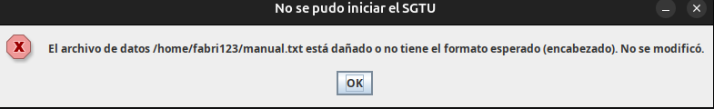

## 7. Límites conocidos
- Una sola instancia a la vez sobre el mismo archivo de datos.
- No hay inicio de sesión ni varios usuarios.
- No se pueden editar ni borrar turnos ya registrados.